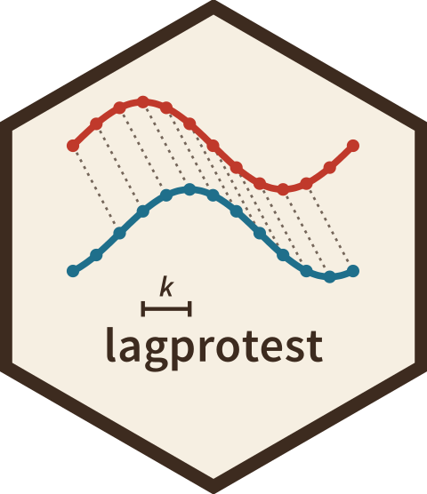

# lagprotest 

<!-- badges: start -->
[](https://github.com/diogoprov/lagprotest/actions/workflows/R-CMD-check.yaml)
[](https://app.codecov.io/gh/diogoprov/lagprotest)
<!-- Uncomment once lagprotest is on CRAN (the badges show an error or "null" before that):
[](https://CRAN.R-project.org/package=lagprotest)
[](https://CRAN.R-project.org/package=lagprotest)
-->
[](https://diogoprov.r-universe.dev/lagprotest)
[](https://doi.org/10.5281/zenodo.23860109)
[](https://opensource.org/license/mit)
[](https://lifecycle.r-lib.org/articles/stages.html#stable)
<!-- badges: end -->

**lagprotest** extends the Procrustean randomization test (PROTEST) to
ordered multivariate series. It scans Procrustes concordance between two
configurations across candidate temporal lags, tests each lag by
permutation, and returns the lag profile, the lag of maximal concordance
(minimum *m*²), a global p-value that accounts for scanning several lags
and selecting the best one, and per-observation Procrustes residuals.

Three permutation schemes are available:

- `permutation = "phase"` (default): phase-randomized surrogates of `Y`,
  which keep the autocorrelation of each variable and the cross-correlations
  among them. Recommended for the global p-value.
- `permutation = "cyclic"`: cyclic shifts of the full series, optionally
  with its time reversal, applied before lagging. Keeps temporal
  autocorrelation under the null, but the global p-value has low power.
- `permutation = "free"`: free permutation of rows, as in
  `vegan::protest()`, applied before lagging. Rows are assumed exchangeable, which
  autocorrelated series violate; Type I error can be severely inflated.

## Installation

From [r-universe](https://diogoprov.r-universe.dev/lagprotest):

```r
install.packages("lagprotest",
                 repos = c("https://diogoprov.r-universe.dev",
                           "https://cloud.r-project.org"))
```

Or the development version from GitHub:

```r
# install.packages("remotes")
remotes::install_github("diogoprov/lagprotest")
```

## Example

```r
library(lagprotest)

# Two 12-month series in which X leads Y by 2 months
sim <- simulate_lagged_series(n_times = 12, true_lag = 2, noise_sd = 0.5,
                              seed = 1)

fit <- lagged_protest(sim$X, sim$Y, lags = 0:4, seed = 1)
fit             # optimal lag, global p, effect measures, lag profile
fit$p.global    # p-value of the whole scan, to report for the optimal lag
fit$effect      # effect lag (largest z), Z, A and corrected RV
plot(fit)       # m2 against lag, with the permutation null quantile
residuals(fit)  # per-observation residuals at the optimal lag
```

Report the global p-value (`fit$p.global`) for the optimal lag: it accounts
for scanning several lags and selecting the best one, whereas the per-lag
p-values do not. The continuous measures in `fit$effect` (`Z`, `A` and the
chance-corrected RV coefficient) describe the strength of the association
and, unlike p-values, are not bounded by the number of permutations.

`lagged_protest_pairs()` runs the scan on every pair of data sets in a named
list and adjusts the global p-values across pairs. The package includes a
real example, `dminutus_liver` (monthly hepatic and climatic series of a
treefrog), analyzed in the article
[Seasonal liver plasticity in a treefrog](https://provetelab.org/lagprotest/articles/liver-example.html).

Inputs can be matrices or data frames (rows = ordered time points,
columns = variables) or `dist` objects, which are converted to principal
coordinates. Rows must form a regular, complete series in time order:
missing or infinite values are errors, and the package has no calendar, so
`period` and lags are counted in rows. See the
[articles](https://provetelab.org/lagprotest/articles/) for choosing a
permutation scheme and simulating series for a calibration study.

## Relation to other software

`vegan::protest()` tests Procrustes concordance between two configurations
at a single alignment of their rows, with free permutation of rows. At lag 0
with `permutation = "free"` and `scale = FALSE`, `lagged_protest()` returns
the same *m*² and correlation. lagprotest improves on that
implementation for ordered series in three ways: it scans concordance
across temporal lags in one or both directions, it provides null
distributions that preserve temporal autocorrelation (phase-randomized
surrogates and cyclic shifts), and it reports a global p-value that
accounts for scanning several lags and selecting the best one.

## Lifecycle

lagprotest is stable. Since version 0.9.0 the names and defaults of
arguments and of the elements of returned objects are frozen; any future
change will go through a deprecation period of at least one minor release,
with a warning, before the old behavior is removed. New arguments are
added with defaults that keep earlier results unchanged. The method and its
calibration are described in a manuscript in preparation.

## License

MIT

## Code of Conduct

Please note that the lagprotest project is released with a
[Contributor Code of Conduct](https://provetelab.org/lagprotest/CODE_OF_CONDUCT.html).
By contributing to this project, you agree to abide by its terms.
